<div align="center">


# Veteran-Ops

### The claim organizer with a game plan.

**Read the record. Understand the rules. Find the next honest move.**

<p>
  <a href="https://github.com/Unicorn-Commander/veteran-ops-oss/stargazers"></a>
  <a href="LICENSE"></a>
</p>

<p><em>Open-source, self-hostable educational software for organizing a VA disability claim.</em></p>

</div>

> **Veteran-Ops** is the application. **Rating Raider** is the in-product agent that talks with you inside it.
>
> Veteran-Ops is an educational organizer. It does not file claims, represent you, diagnose you, sign
> evidence for you, promise an outcome, or replace a VA-accredited representative. Bring the plan to a
> provider or a free VA-accredited VSO.

---

## What it looks like

Every screenshot below is the **real React application**, driven by Playwright against **synthetic demo
data**. There is no veteran here: no real name, email, date of birth, address, claim number, decision
letter, or document. The fixture record belongs to "Synthetic Veteran," and you can read every byte of
it in [`frontend/e2e/synthetic.ts`](frontend/e2e/synthetic.ts).

### The front door

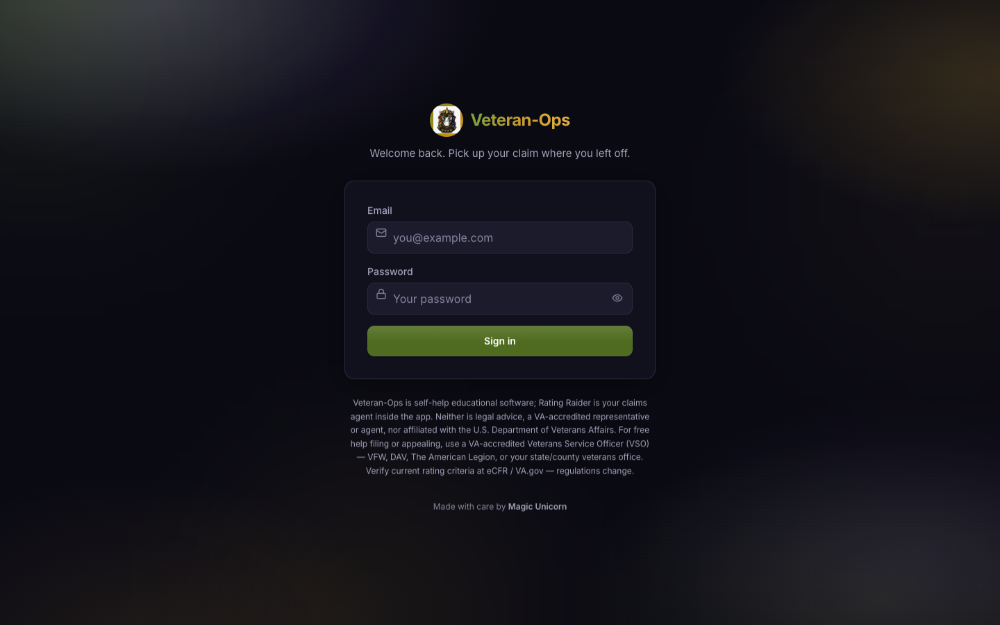

The legal boundary is on the sign-in screen, before an account exists — Veteran-Ops is self-help
software, Rating Raider is the agent inside it, and neither is a VA-accredited representative.

### Guided setup

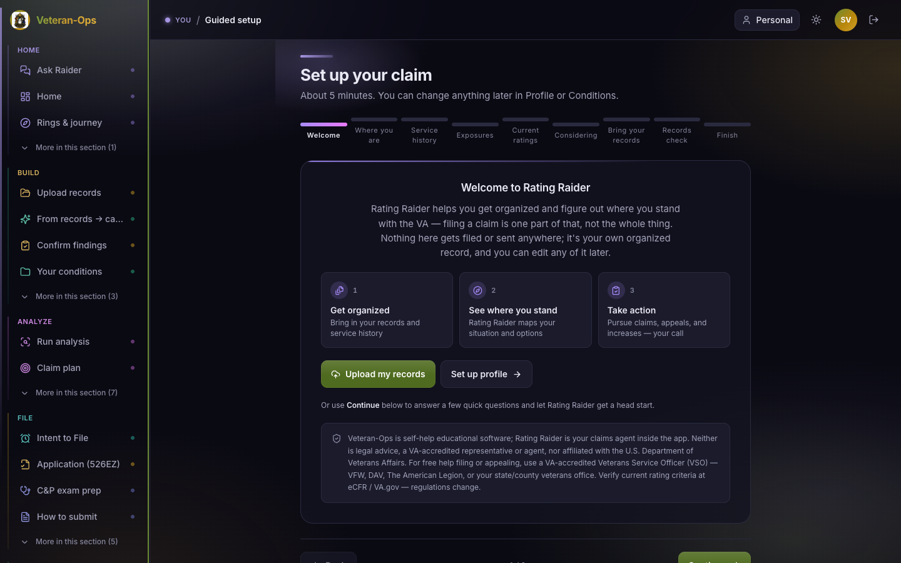

Nine short steps: where you are, service history, exposures, current ratings, what you're considering,
and a records check. Nothing gets filed or sent anywhere — it becomes your own organized record, and
you can edit any of it later.

### Analysis Center

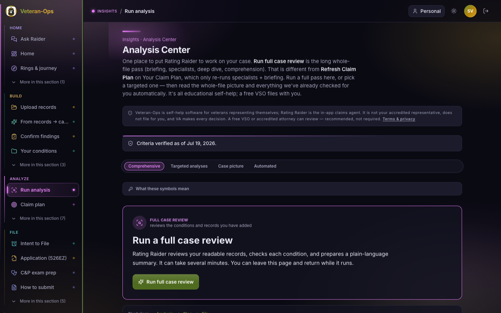

The long pass over your whole file: briefing, specialists, rating deep dive, and whole-case
comprehension. It's deliberately distinct from the quicker **Refresh Claim Plan**, and the page says so
rather than leaving you to guess which button you wanted.

### Rating Raider offers the gap interview

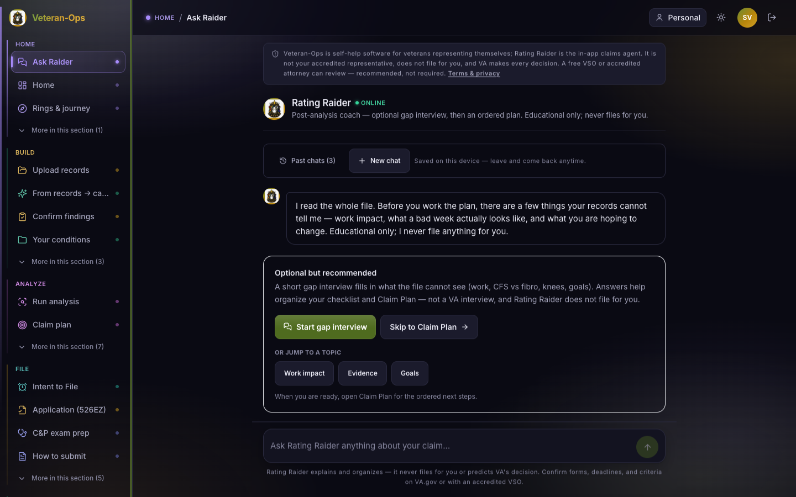

After a full review, Rating Raider offers a short interview about what your file **cannot** show — work
impact, trade-offs, goals. It's optional and clearly labelled as such, and you can skip straight to the
Claim Plan.

### Rating Raider in conversation

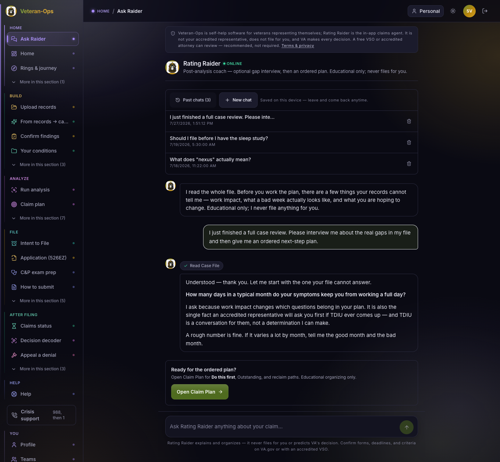

The agent surface: **Rating Raider** named as the agent, **Past chats** and **New chat** stored in this
browser only, one question at a time, and a visible hand-off back to the deterministic Claim Plan when
the conversation is done. Note what the answer does — it asks, explains why it's asking, and routes the
TDIU question to an accredited representative instead of answering it.

### The Claim Plan

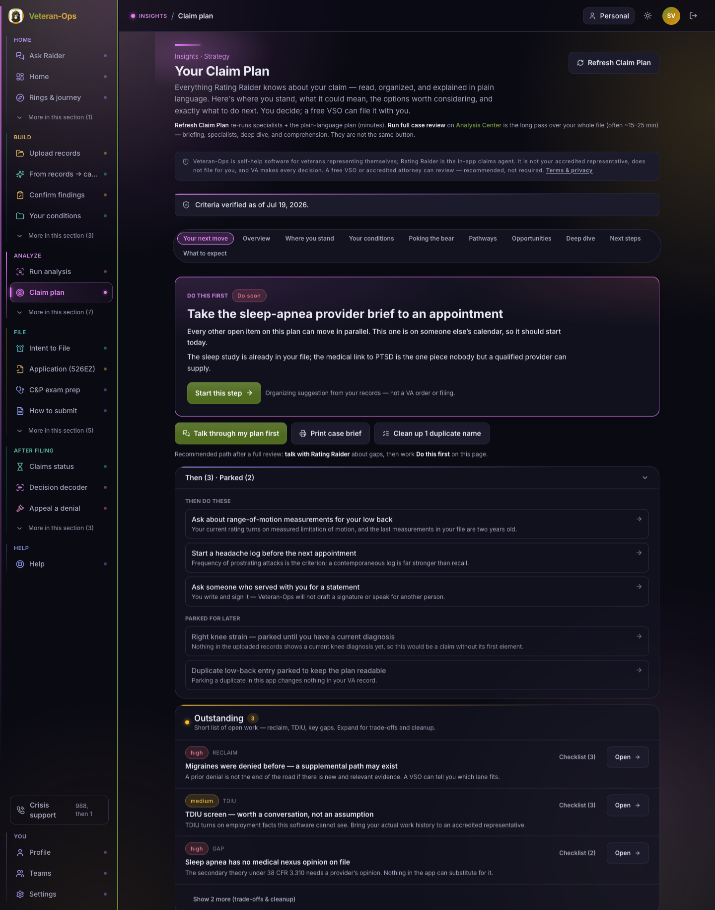

One ranked queue instead of a wall of advice: **Do this first**, **Then**, **Parked**, and a short
**Outstanding** list with severity and per-item checklists. Every card carries its reasoning, and the
top card says plainly that it is "an organizing suggestion from your records — not a VA order or
filing."

### Evidence organizer

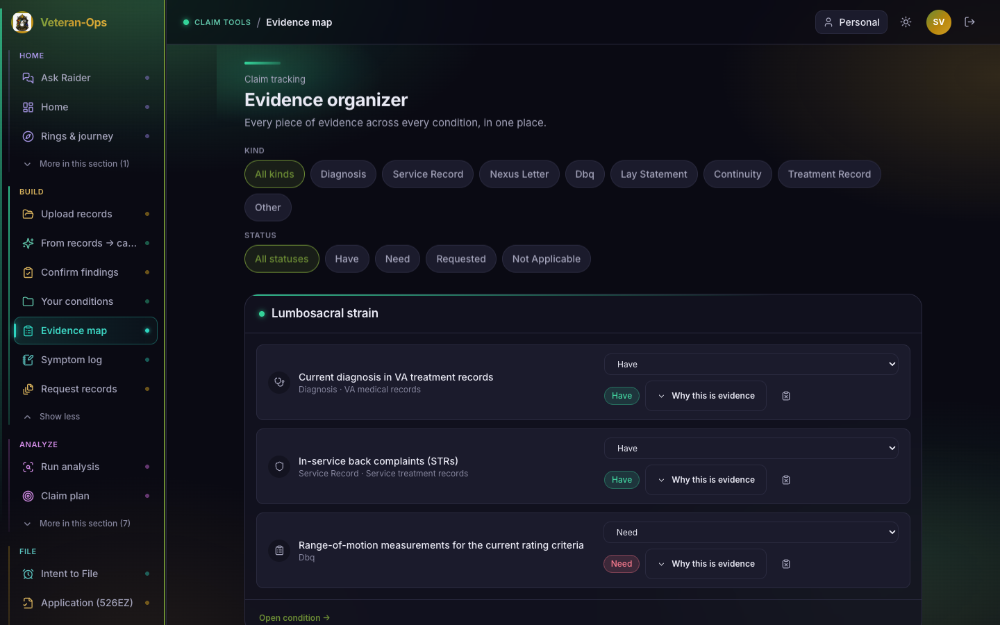

Every piece of evidence across every condition in one place, grouped by condition and filterable by
kind and status. "Why this evidence" explains which element of service connection each item speaks to.

### Case brief — the printable hand-off

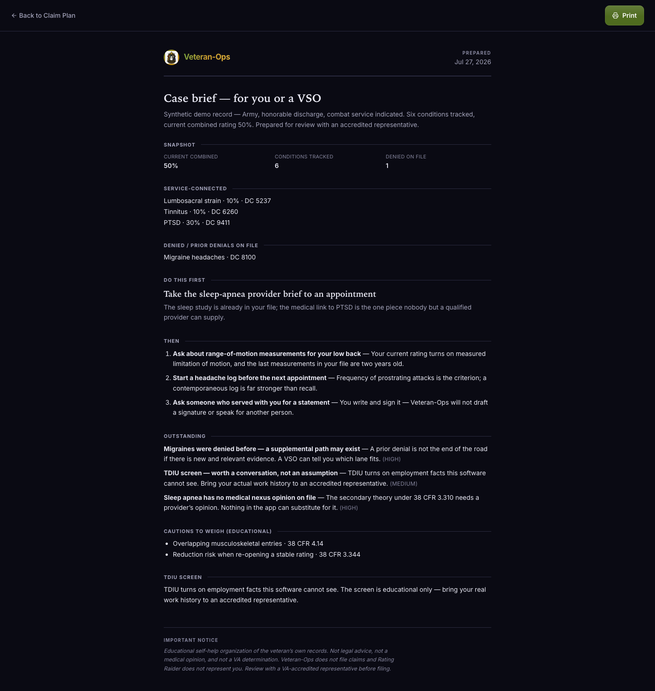

The page to print and take to an appointment: snapshot, service-connected and denied conditions, Do
this first, Then, Outstanding, cautions to weigh, the TDIU screen, and the disclaimer — on one sheet, in
the order a representative will want to read it.

### On a phone

<div align="center">
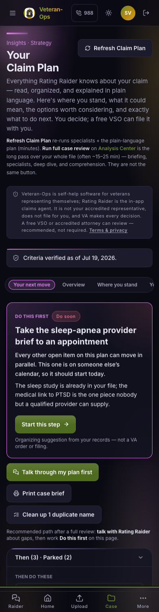
</div>

The same Claim Plan at 390px. The Veterans Crisis Line (988, then 1) sits in the mobile header and in the
desktop sidebar — always one tap away, on every screen.

---

## Show this to a veteran

### What this helps with

- **Reading your own record.** It ingests what you upload and tells you what it found, condition by condition.
- **Knowing what's actually missing.** Not "gather evidence" — *which* piece, for *which* element, and who can supply it.
- **One next move.** A ranked plan with a single top item, so the file stops being a wall.
- **Better appointments.** Printable provider briefs and a case brief, so a 20-minute visit is spent well.
- **Understanding the rules.** Plain-language explanations of criteria and trade-offs, with the regulation cited so you can check it yourself.
- **Keeping your own copy.** Self-hostable, AGPL-licensed. Your records can stay on your own machine.

### What it does not do

- **It does not file anything.** No claim, no form, no submission — ever. You file, or a VSO files with you.
- **It does not represent you.** It is not a VA-accredited representative, attorney, or agent, and it is not affiliated with the U.S. Department of Veterans Affairs.
- **It does not diagnose you.** Only a qualified provider does that.
- **It does not sign or ghost-write evidence.** It will not draft a buddy statement in someone else's voice, produce a nexus opinion, or put a signature on anything. Those must come from the actual person.
- **It does not promise an outcome.** No rating prediction, no back-pay guarantee. Where it does arithmetic (38 CFR 4.25 combined ratings), it says on the card that the math runs on the targets *you* entered.
- **It does not replace a VSO.** VA-accredited representation is free. Using it is recommended, not required.

### Your first 10 minutes

1. **Create an account** and run guided setup — branch, service periods, exposures, current ratings.
2. **Add the conditions** you're already rated for and the ones you're considering.
3. **Upload what you have.** DD-214, STRs, C-file, VA and private medical records. Missing something? The Records page generates the request.
4. **Run the full case review** from Analysis Center and let it read the whole file.
5. **Talk to Rating Raider** for a few minutes about what your records can't show — how work actually goes, what a bad week looks like.
6. **Open Claim Plan → Do this first.** One item. Start there.
7. **Print the case brief** and book time with a free VA-accredited VSO.

You can stop at any step and come back. Nothing is submitted, and nothing expires because you closed the tab.

---

## For VSOs and accredited representatives

If you're deciding whether this is safe to recommend, these are the boundaries the software is built to hold:

| Boundary | How it shows up in the product |
| --- | --- |
| **Educational organizer only** | Every page carries the standing disclaimer; the Claim Plan's top card labels itself an organizing suggestion, not a VA order. |
| **No filing** | There is no submission path. Forms are produced for the veteran to review, sign, and file themselves. |
| **No representation** | The disclaimer names VSOs, VFW, DAV, The American Legion, and state/county offices as the accredited route — by name, not as a footnote. |
| **No diagnosis** | Clinical questions are routed to a provider. The app records what the record says; it does not conclude. |
| **No ghost-signed evidence** | Buddy statements and nexus opinions are prepared *for a human to write and sign*. The product must not fabricate, sign, or impersonate — see [SECURITY.md](SECURITY.md), which treats a violation as a reportable safety issue. |
| **No outcome guarantees** | Combined-rating math states its basis on the card. Prior denials produce "a supplemental path may exist," not "you will win." |
| **Human review recommended** | The Claim Plan's own recommended path ends at a person: "a free VSO can file it with you." |
| **Trade-offs surfaced, not hidden** | Pyramiding (38 CFR 4.14), reduction risk on re-opening (38 CFR 3.344), and TDIU employment facts are shown as things to weigh *before* acting. |

The rating criteria the product reasons over are versioned and dated — see [docs/RULE-VERSIONS.md](docs/RULE-VERSIONS.md) — and the UI displays "criteria verified as of" so a stale knowledge base is visible rather than silent. A line-by-line review of the product's legal language lives in
[docs/LEGAL-ACCURACY-AUDIT-2026-07-26.md](docs/LEGAL-ACCURACY-AUDIT-2026-07-26.md).

---

## Why this exists

VA claims are not just a pile of documents. They are a long-running reasoning problem: what happened,
what is documented, what rule might apply, what is still missing, and what should be discussed with a
qualified human before filing?

Veteran-Ops turns that fog into a calm, auditable workspace. **Rating Raider**, its in-product agent,
helps you ask better questions while the deterministic Claim Plan keeps the important next moves
visible.

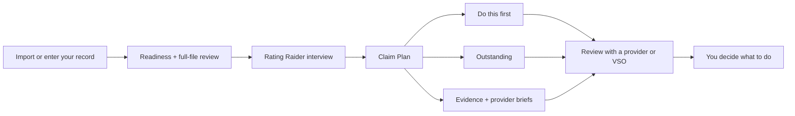

## Meet Rating Raider


**Rating Raider** is the conversational agent inside Veteran-Ops — the flagship of the app's agent
surface, not the app itself. Raider reads the case file you've assembled, asks one question at a time
about what the record can't show, explains criteria in plain language, and then hands the conversation
back to the deterministic Claim Plan.

What Raider will not do is as deliberate as what it will: it does not file, does not represent, does
not diagnose, does not sign, and does not predict a decision. Where a question turns on facts the
software cannot see — employment history for TDIU, for instance — Raider says so and routes it to an
accredited representative.

Conversations are stored in **your browser only**. Past chats, new chat, delete, and `?c=` deep links
all work without a server-side transcript.

<br clear="right" />

## What makes it different

| Capability | What you get | Why it matters |
| --- | --- | --- |
| **Claim Plan coach** | Ranked **Do this first**, quieter **Outstanding** queue, parked duplicates | Less overwhelm; a visible next move |
| **Rating Raider** | One-question-at-a-time gap interview and plain-language explanations | Your file cannot answer questions about work, symptoms, goals, or trade-offs |
| **Claim-safety lane** | Prompts for CFS/fibro trade-offs, TDIU employment facts, mental-health criteria, reductions, and reclaims | Surfaces questions to weigh before you act |
| **Evidence workspace** | Evidence checklist, situation brief, nexus-provider brief, and case brief | Makes a conversation with a provider or VSO more productive |
| **Decision overlay** | Formal VA decision-letter statuses, with opt-in application | Keeps "what the letter says" separate from analysis or C&P noise |
| **Local chat history** | Past chats, New chat, delete, and `?c=` deep links | Navigate away without losing the thread; stored in this browser only |
| **Self-hostable stack** | Docker Compose, Postgres, FastAPI backend, React/Vite frontend, and an LLM gateway seam | Own the deployment boundary and data path |

## The Claim Plan is a ranked queue, not a wall of advice

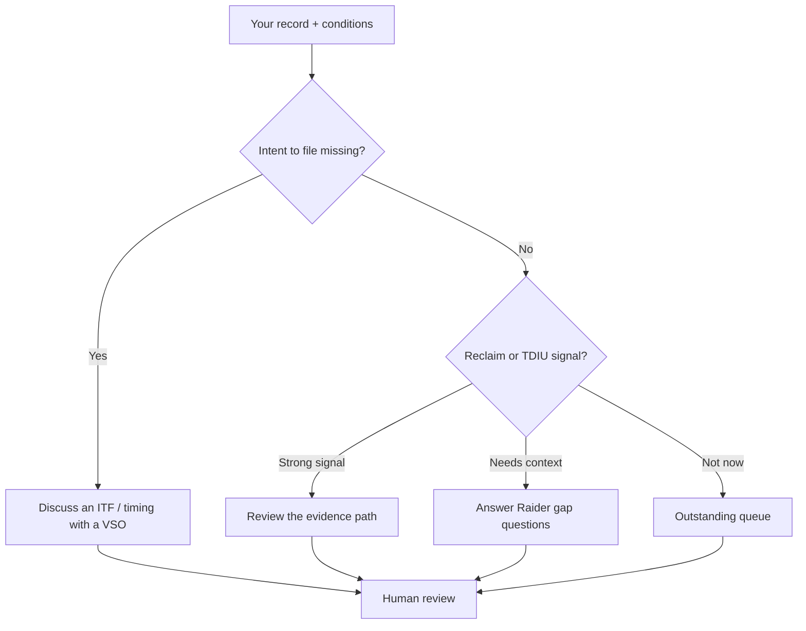

The ranking is an organizer's recommendation about what to review first — not a rating prediction or a
filing instruction.

---

## Quick start: self-host

```bash
git clone https://github.com/Unicorn-Commander/veteran-ops-oss.git
cd veteran-ops-oss
cp .env.example .env          # then edit it — see below
docker compose up -d --build
curl -fsS http://localhost:5174/api/healthz
```

The stack comes up on ports offset so it can run beside other suites: Postgres `5434`, backend `8001`,
frontend `5174`, MCP `8766`. (The root `docker-compose.yml` reads the repo-root `.env`; the deployment
compose files under `infrastructure/` read `infrastructure/.env`, which has its own example alongside them.)

Before you start, set real values in `.env`:

- **`JWT_SECRET`** — at least 32 random characters. Generate it, don't invent it:
  `python -c "import secrets; print(secrets.token_urlsafe(48))"`
- **`POSTGRES_PASSWORD`** and **`APP_DB_PASSWORD`** — the app connects as the non-superuser `valor_app`
  role on purpose, because row-level security is skipped entirely for superusers and `BYPASSRLS` roles.
- **`LLM_BASE_URL`** — any OpenAI-compatible endpoint (LiteLLM, vLLM, Ollama, llama.cpp server). There
  is no sensible default; point it at your own gateway.
- **`CORS_ORIGINS`** — the origins your frontend is served from.
- **`ALLOW_REGISTRATION=false`** for a public instance. The first account still bootstraps so you can
  create your own login once; after that the endpoint 403s.

Never commit `.env`. The full experience expects Postgres and an OpenAI-compatible LLM gateway; without
a gateway the deterministic organizer still works and Rating Raider reports itself unavailable rather
than failing loudly.

Operational detail — backups, restore, upgrades, SLOs — lives in [docs/OPERATIONS.md](docs/OPERATIONS.md)
and [docs/SLO-RUNBOOK.md](docs/SLO-RUNBOOK.md).

## Architecture

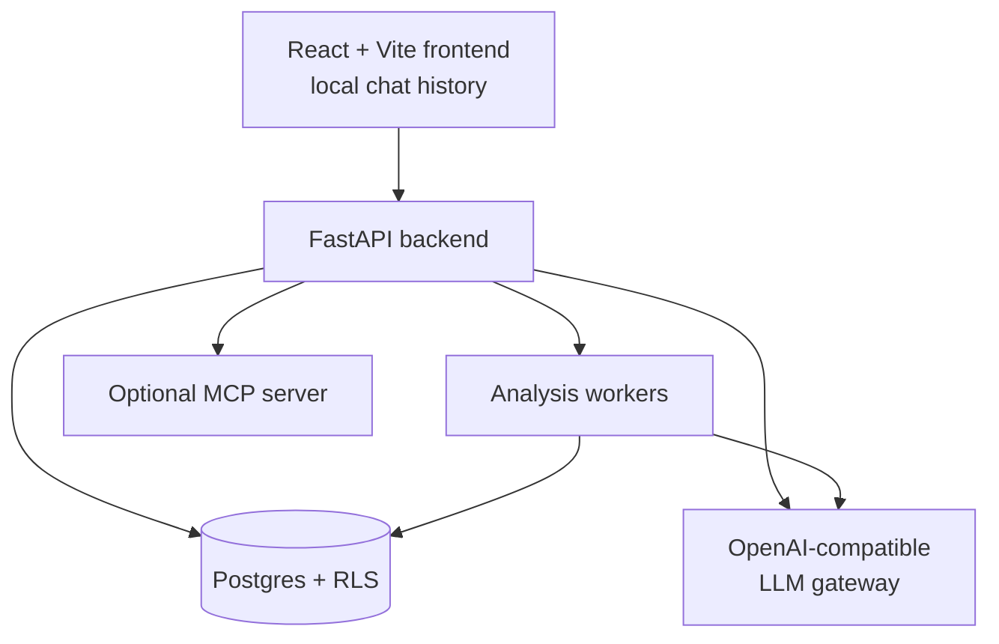

The application separates **deterministic claim-organization logic** from **model-assisted
conversation**. A model can explain and ask questions; the product still needs inspectable rules,
versioned criteria, and explicit human decisions. That split is the reason the Claim Plan is
reproducible while Rating Raider is conversational — and the reason a model outage degrades the app
rather than breaking it.

Tenant isolation is enforced in Postgres via row-level security, which is why the application role is
deliberately not a superuser.

```text
backend/            FastAPI API, strategy engine, auth, workers, tests
frontend/           React/Vite application and browser-local Raider history
frontend/e2e/       Playwright specs, including the synthetic README gallery
mcp/                Optional Model Context Protocol adapter
browser-extension/  Optional reading/workflow helper
db/                 Postgres init, roles, and RLS setup
infrastructure/     Deployment compose examples (app host + TLS edge) and env template
docs/               Product rules, operations, legal, release, and research notes
scripts/            Release hygiene, backup/restore verification, and Postgres RLS tests
```

## Development

```bash
npm ci --prefix frontend
npm run build --prefix frontend
npm run test --prefix frontend -- --run
npm run test:e2e --prefix frontend
python -m pytest -q backend/tests/test_coach.py backend/tests/test_strategy.py
git diff --check
gitleaks detect --source .
trufflehog filesystem . --no-update
```

To refresh the README screenshot gallery:

```bash
README_SCREENSHOTS=1 npm run test:e2e --prefix frontend -- --project=desktop-chromium
```

The gallery specs live in [`frontend/e2e/showcase.spec.ts`](frontend/e2e/showcase.spec.ts) and are inert
unless `README_SCREENSHOTS` is set. They drive the real UI against the fixtures in
[`frontend/e2e/synthetic.ts`](frontend/e2e/synthetic.ts) — if you extend the gallery, keep the fixtures
realistic in shape and obviously synthetic in content.

## Trust, privacy, and legal boundaries

- **Educational only.** Veteran-Ops is not a law firm, VSO, medical provider, or VA service, and is not affiliated with the U.S. Department of Veterans Affairs.
- **No filing, no representation.** There is no submission path in the product. You file, or an accredited representative files with you.
- **No diagnosis.** Clinical conclusions belong to a qualified provider.
- **No ghost-written evidence.** The product must not fabricate, sign, or impersonate a veteran, buddy, or nexus provider.
- **No outcome promises.** A possible path is not an entitlement determination, and combined-rating arithmetic states its own basis.
- **Formal decisions stay formal.** Decision-letter status overlays are opt-in and kept distinct from analysis and C&P exam language.
- **You stay in control.** Opt-in actions require your decision; the software does not submit a claim.
- **Protect the record.** Do not place real veteran records, secrets, keys, or production uploads in a public issue or pull request.

Read the full [legal accuracy audit](docs/LEGAL-ACCURACY-AUDIT-2026-07-26.md), the
[security policy](SECURITY.md), the [branding and copy rules](docs/BRANDING.md), and the
[operations guide](docs/OPERATIONS.md).

## Contributing

Read [CONTRIBUTING.md](CONTRIBUTING.md) and [SECURITY.md](SECURITY.md). Keep changes small, legal
language precise, tests behavior-level, and all data synthetic or de-identified. Explain what was
verified and which operator or human gates remain.

Two naming rules, because they are easy to get wrong and they matter to veterans reading the UI:
**Veteran-Ops** is the app, product, and platform. **Rating Raider** is the in-product agent, and that
name belongs to the agent surface only. See [docs/BRANDING.md](docs/BRANDING.md).

## License

Veteran-Ops is released under the [GNU Affero General Public License v3.0 or later](LICENSE).

<div align="center">

**Organize honestly. Ask better questions. Bring the plan to a human.**

<br />

*If you are a veteran in crisis, call the Veterans Crisis Line: **988, then 1**.*

</div>
